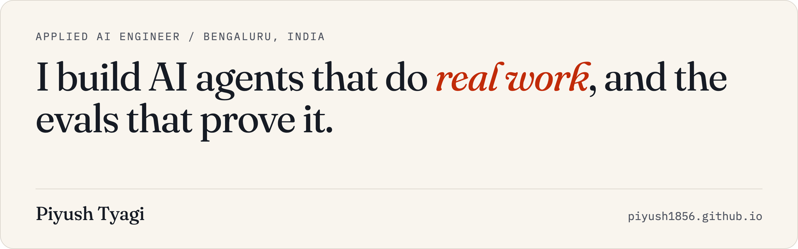

<a href="https://piyush1856.github.io">
  <picture>
    <source media="(prefers-color-scheme: dark)" srcset="https://raw.githubusercontent.com/piyush1856/piyush1856/main/assets/banner-dark.png">
    
  </picture>
</a>

 

Hi, I'm Piyush, an Applied AI Engineer with 3+ years across backend and LLM systems.

Most recently at WizCommerce I built **WizPilot**, an agentic assistant that B2B sales teams use to run CRM, catalog, cart and analytics work in plain language. Before that I worked on **Fynix**, an AI coding assistant at Fynd, and was on the founding backend team of two B2B commerce startups.

**Open to Applied AI Engineer roles.**

[Portfolio](https://piyush1856.github.io) · [Resume (PDF)](https://piyush1856.github.io/Piyush_Tyagi_Resume.pdf) · [LinkedIn](https://www.linkedin.com/in/piyush-tyagi-308930246) · [LeetCode](https://leetcode.com/piyush1856) · [Email](mailto:piyushtyagi28@hotmail.com)

## What I build

| Area | In production |
| --- | --- |
| **Agent platforms** | A LangGraph orchestrator with domain-specialist sub-agents on a multi-tenant runtime. Models, prompts and tool bindings come from database config. |
| **MCP tool platforms** | 200+ typed, permission-checked tools across CRM, catalog, cart and analytics. Dynamic tool compression cut tool-schema prompt tokens by about 90%. |
| **Evals and reliability** | An eval harness in CI: 100+ prompts from real traffic, about 50 deterministic checks, LLM-as-judge scoring, and A/B runs tracked in LangSmith. |
| **Retrieval and NL-to-SQL** | A five-stage NL-to-SQL pipeline on BigQuery with SQL self-correction and row-level access control. Hybrid BM25 and vector search with RRF and reranking. |
| **Agents that act** | A code sandbox where the agent runs its own Python, a browser agent that works inside web apps, and file understanding for PDFs, spreadsheets and images. |
| **Guardrails and cost** | Confirmation before destructive actions, per-tool permission checks, PII scrubbing, and LiteLLM routing with per-tenant cost attribution. |

## Experience

| Role | Company | When |
| --- | --- | --- |
| Software Development Engineer I (Backend & AI) | WizCommerce | Sep 2025 – Dec 2026 |
| Software Development Engineer I (GenAI) | Fynd | Feb 2025 – Aug 2025 |
| Backend Developer, founding team | Growder and Ompax | Mar 2023 – May 2024 |

The details are on my [portfolio](https://piyush1856.github.io) and in my [resume](https://piyush1856.github.io/Piyush_Tyagi_Resume.pdf).

## Stack

| Area | Tools |
| --- | --- |
| **Agents and LLMs** | LangGraph, LangChain, MCP, LiteLLM, OpenAI, Anthropic Claude, Google Gemini |
| **Retrieval** | Qdrant, Elasticsearch, Voyage AI, hybrid search, reranking, NL-to-SQL |
| **Evals and observability** | LLM-as-judge, LangSmith, Langfuse, Sentry, Prometheus, Grafana |
| **Backend and data** | Python, FastAPI, Java, Spring Boot, PostgreSQL, BigQuery, Redis, Kafka |
| **Cloud** | GCP, AWS, Docker, Kubernetes |

## Public code

Most of my recent work is in private company repositories. These are public:

- [design-patterns-low-level-design](https://github.com/piyush1856/design-patterns-low-level-design): design patterns and low-level design in Java
- [Artic-Tern-Trip-Management-RESTful-API](https://github.com/piyush1856/Artic-Tern-Trip-Management-RESTful-API): REST API for a trip management system, in Java
- [machine-learning-algorithms](https://github.com/piyush1856/machine-learning-algorithms), [neural-network](https://github.com/piyush1856/neural-network) and [time-series-and-recommendation-system](https://github.com/piyush1856/time-series-and-recommendation-system): machine learning notebooks
- [piyush1856.github.io](https://github.com/piyush1856/piyush1856.github.io): the source of my site

## Also

- MCA in Machine Learning and Artificial Intelligence, Amity University (2025)
- 300+ DSA problems solved on LeetCode and other platforms
- Played table tennis at state level (U-16)
